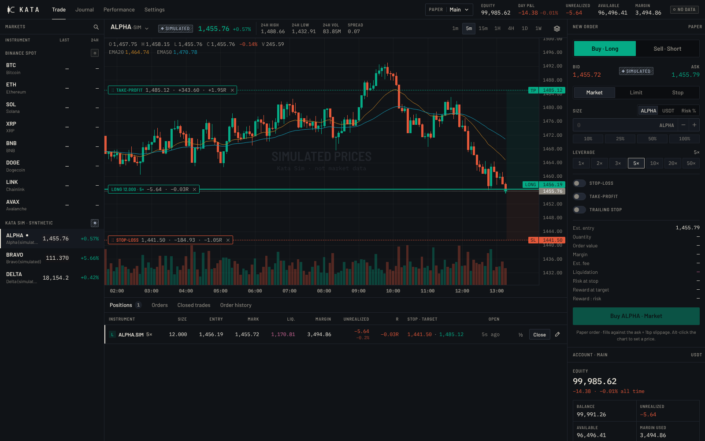

# Kata — Rehearse every trade

Kata is an installable paper-trading terminal (PWA). It runs on real market prices with simulated money, and every result is reported honestly. It is a training tool, not a brokerage. **No real orders are ever placed.**



## Run it

```bash
cd kata
npm install
npm run dev          # http://localhost:5173
npm test             # 60 unit tests: engine, analytics, indicators, market data
npm run e2e          # 10 Playwright tests against the production build (PWA, trading, Binance path, mobile)
npm run build        # production build in dist/ (with service worker)
npm run preview      # serve the build on http://localhost:4173 (install it from here)
```

Deploying: point any static host at `kata/` with `npm run build` and output `dist/`. On Vercel, set the project's Root Directory to `kata`; `vercel.json` adds the cache headers the service worker needs. Install is offered in Chrome, Edge and Android once the site is served over HTTPS; on iPhone, use Safari → Share → *Add to Home Screen*.

## Brand

| | |
|---|---|
| **Name** | Kata: the practised form a martial artist repeats until it is exact. Paper trading is the same rehearsal. |
| **Slogan** | *Rehearse every trade.* |
| **Mark** | A candlestick forms the K's stem, and its arms are a bracket order: take-profit above, stop-loss below. The target arm is longer, so the logo is a trade with positive risk/reward. |
| **Palette** | “Ink & paper”. The brand itself is monochrome (sumi ink `#0B0D10`, washi paper `#ECE7DC`). Colour is reserved for information: direction, working orders, and data provenance. Direction pairs and indicator colours are validated for colour-vision deficiency, and a blue/orange palette is one click away. |
| **Type** | Barlow (UI), Barlow Semi Condensed (labels), IBM Plex Mono (every number, tabular). Self-hosted for offline use. |
| **Launch** | An inline HTML/SVG launch screen draws the mark (wick, body, then the bracket) while the engine boots. iOS gets 36 generated launch images; Android builds its splash from the manifest. |

Assets are generated from source: `node scripts/wordmark.mjs` turns the font into wordmark paths, `npm run icons` renders the icons, launch images and social card, and `node scripts/screens.mjs <url>` captures the manifest screenshots.

## Data honesty

Every price surface carries a provenance tag, and every fill records one.

| Tag | Meaning |
|---|---|
| **Live** | Binance public spot data streamed over WebSocket (best bid/ask, candles, 24h stats). No key, no account. |
| **Delayed** | Real data that isn't streaming: the socket is down and Kata is polling every 3 s, or updates are more than 5 s old. The age is shown. |
| **No data** | No usable price for 30 s. Market orders and manual closes are paused, because nothing is ever filled against a made-up price. |
| **Simulated** | Kata Sim instruments (`ALPHA·SIM`, `BRAVO·SIM`, `DELTA·SIM`): a deterministic synthetic process for offline practice, hatched and watermarked everywhere. |
| **Replayed** | Fills reconstructed from real historical candles for time the app was closed. |

Binance hosts are tried in order: `data-api.binance.vision` / `data-stream.binance.vision` (market data only), then `api.binance.com` / `stream.binance.com`. Binance does not serve some regions; there the app shows *No data* rather than inventing prices.

## Trading model

- **Instruments:** Binance USDT spot pairs (any of them, via search) plus Kata Sim. Exchange filters (tick, lot step, minimum notional) come from `exchangeInfo`.
- **Positions:** each filled entry opens its own position (hedging model), so one position is one journal trade. Long and short, leverage 1–50× (configurable up to 125×).
- **Margin:** isolated per position. Liquidation happens when margin + uPnL reaches maintenance margin (0.5% of notional), and forfeits exactly that position's margin.
- **Orders:** market, limit and stop entries, each with optional attached stop-loss, take-profit and trailing stop. Working orders reserve margin plus a worst-case fee.
- **Execution:** buys fill at the ask and sells at the bid, with 1 bp adverse slippage on taker fills, rounded to the tick against you. Resting limits and take-profits fill at their price as maker. Stops fill at the touch, so gaps fill worse.
- **Fees:** 0.05% taker and 0.02% maker by default; all costs are editable per account. Funding and borrow costs are not modelled.
- **Management:** drag stops, targets and order prices on the chart, with live P&L and R while dragging. Keyboard works too: focus a level and use ↑/↓, then Enter. Also: partial closes, stop-to-breakeven, close all, cancel all.
- **Risk controls:** daily loss limit (locks entries until 00:00 UTC), max drawdown lock, max risk per trade, mandatory stop-loss, max open positions, and optional flatten-on-lock.
- **Time away:** when you return, Kata replays real 1m candles (coarser for long gaps) through the engine, so stops, targets, limits and liquidations behave as if you had stayed. Within a candle the order is unknown, so bullish candles are assumed to visit their low first and bearish candles their high. Prices never act on orders or positions that didn't exist yet. You get a *While you were away* summary.
- **One engine:** a Web Lock ensures only one tab executes orders.

All money math lives in `src/engine` as pure functions. `engine.test.ts` checks fills, fees, slippage, partial closes, brackets, trailing stops, liquidation, locks, replay ordering and a randomized ledger invariant: balance always equals deposits plus net results.

## Analytics & journal

Performance shows net P&L, win rate, profit factor, expectancy ($ and R), average win/loss and payoff, max drawdown (realized and marked), total R, streaks, holding time, the realized balance curve, drawdown, the R distribution, a daily P&L calendar, and breakdowns by instrument, direction and exit reason. All figures are net of fees. 1R is the loss at the first stop placed.

The journal attaches a setup, tags, an execution rating, state of mind, mistakes and notes to each closed trade, and shows the trade on its original chart. Clicking any closed trade, or its marker on a chart, opens it in inspect mode.

## Architecture

```
src/
  engine/      pure trading engine, analytics, sizing (+ tests)
  market/      Binance adapter, Kata Sim, MarketHub (stream → poll → offline)
  indicators/  EMA, SMA, Bollinger, VWAP, RSI, MACD, ATR (+ tests)
  db/          IndexedDB schema (Dexie): accounts, orders, positions, fills, ledger, equity, journal
  store/       runtime (engine runner, persistence, leader lock, replay), Zustand stores
  features/    chart (Lightweight Charts + overlay), ticket, trade, journal, performance, settings
  brand/ ui/   mark, wordmark, loader; design-system primitives and icon set
```

Stack: Vite, React 19, TypeScript (strict), Lightweight Charts v5, Dexie, Zustand, vite-plugin-pwa (Workbox), Vitest and Playwright. Market data is never cached by the service worker.

Charts are drawn with [TradingView Lightweight Charts™](https://www.tradingview.com/lightweight-charts/) (Apache 2.0).
